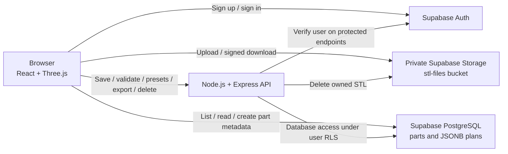

# Armatrix Weld Seam Planner

A web app for uploading an STL part, selecting weld seams on its 3D model, setting MIG/TIG parameters, arranging the weld order, and downloading a JSON weld job.

This guide starts from a fresh computer and a new Supabase project. The React frontend and Express API run locally; Supabase hosts authentication, PostgreSQL, and private STL storage. An internet connection is required. This setup does not require Docker, a local PostgreSQL installation, or the Supabase CLI.

[Features](#features) · [Architecture](#architecture) · [Key design decisions](#key-design-decisions) · [Local setup](#requirements) · [Exported JSON schema](#exported-weld-job-json-schema) · [Troubleshooting](#troubleshooting)

## Features

- Email/password sign-up, sign-in, sign-out, and protected planner pages.
- Private STL uploads through a file picker or drag and drop, a saved parts list, and part deletion.
- Binary and ASCII STL viewing with download progress, dimensions, triangle count, file-unit selection, and Y/Z up selection.
- Orbit, pan, zoom, fit, isometric/top/front/right views, and shaded/edge/wireframe display modes.
- Seam selection by tracing feature edges, including closed loops and splitting joints around intersecting geometry. Manual path drawing snaps points to nearby corners and edges.
- Seam selection, deletion, weld-order changes, direction reversal, and start/end trimming for open paths.
- MIG/TIG parameters, presets, copying parameters to all seams, validation warnings, and length/time/heat-input readouts.
- Debounced auto-save, a saved/error indicator, and conflict detection when another window saves the same part.
- JSON export with ordered, trimmed seam paths in millimetres and the selected process parameters.

## Architecture



The browser owns the interactive editing session: it parses the STL, renders the model, finds selectable feature edges, and keeps the current plan in React state. Supabase stores accounts, part records, saved plans, and STL files. Express provides the welding rules and builds the exported job.

| Operation | Request path |
| --- | --- |
| Sign up / sign in / sign out | Browser → Supabase Auth |
| Upload an STL and create its part record | Browser → Supabase Storage, then PostgreSQL |
| List or open a part | Browser → Supabase PostgreSQL |
| Download the STL for viewing | Browser → Supabase signed URL → Storage |
| Fetch presets or check a plan | Browser → Express; these two endpoints are public |
| Save a plan, delete a part, or export a job | Browser → Express with a user token → Supabase under that user's permissions |

### Upload and export flows

An upload first stores the file at `<user-id>/<random-uuid>.stl`, then inserts its metadata into `public.parts`. If the metadata insert fails, the frontend attempts to remove the uploaded file. These are separate operations, so cleanup is a compensating action rather than an atomic transaction.

Export loads the saved plan through the authenticated API, validates it again, applies trims and unit conversion, and returns the JSON. The frontend downloads that response without rebuilding or modifying its fields. Export is disabled while the editor reports unsaved changes.

## Key design decisions

### React and Vite for an interactive editor

React keeps the seam list, selected seam, parameter fields, and viewer props connected to the same plan state. Small components make each interaction easier to follow, while `useStl` and `usePlan` contain loading and saving behavior. Auth is shared through Context; editing state stays close to the workspace, so a global state library is unnecessary for the current scope. This follows React's [state-driven UI model](https://react.dev/learn/state-a-components-memory).

Vite provides the development server and produces a static frontend build. The app does its 3D work in the browser, so a server-rendering framework would add little to the current editor workflow. Pages and the viewer use dynamic imports; hover/focus preloading warms their JavaScript modules before navigation. It does not prefetch a part's database row or STL.

### Three.js and React Three Fiber for browser geometry

Three.js supplies STL parsing, geometry, edge extraction, camera controls, and the tube meshes used to display seams. React Three Fiber connects scene objects to React props and events, so selecting a seam in the sidebar can update the same seam in the canvas.

Parsing and picking happen locally after download, which avoids a server round trip for every cursor movement. The tradeoff is browser CPU/GPU and memory use. The viewer renders on demand, disposes of geometry during cleanup, and skips feature-edge graph creation above 400,000 triangles. Manual drawing remains available, and simpler meshes are preferable for large parts. Edge tracing is a geometric heuristic rather than automatic recognition of every valid weld joint.

### Node.js and Express for the welding API

JavaScript is used across the browser and API, which makes the JSON plan and parameter names easy to follow through both sides. Express supplies a small route/middleware layer for presets, validation, saving, deletion, and export. The API spends much of its time waiting for Supabase requests, which fits Node's [asynchronous I/O model](https://nodejs.org/learn/getting-started/introduction-to-nodejs).

This backend does not need to receive or parse the STL to export a job: the saved plan already contains its seam points. Expensive mesh processing or robot motion planning would need a separate execution strategy if added later.

### Supabase for authentication, PostgreSQL, and private files

Supabase gives the project one user identity across authentication, database records, and file access. The `parts.user_id` foreign key ties a part to its owner, and PostgreSQL Row Level Security uses `auth.uid()` to check ownership. Storage policies apply the same identity to the first folder in each file path.

This keeps the project focused on seam planning instead of implementing password handling, session infrastructure, and an object-storage service. PostgreSQL provides relational ownership and timestamps, while JSONB holds the editable plan. The tradeoff is a dependency on a hosted service and network access; local frontend/API servers do not make the app fully offline.

### Direct browser uploads instead of proxying STL files through Express

The file is already in the browser and its final destination is Supabase Storage. Sending it directly avoids making the API receive and forward up to 50 MB for each upload. Express handles small JSON requests and does not need multipart upload handling, temporary files, or a large upload body limit. Its current JSON request limit is 2 MB.

Direct upload still goes through Supabase's server-side access controls. The browser sends a publishable key and the user's access token; the private bucket's policies check the user-ID folder, and the bucket enforces the file-size cap. A publishable key is intended for client applications and grants only the access allowed by the configured policies. See [Supabase API keys](https://supabase.com/docs/guides/getting-started/api-keys) and [Storage access control](https://supabase.com/docs/guides/storage/security/access-control).

The frontend extension/size checks provide immediate feedback. They are not a replacement for server-enforced limits or content validation: this app parses STL content when opening the model, after upload. Routing files through Express would be useful if uploads needed server-side inspection, conversion, or processing before storage. The current upload uses a standard request rather than a resumable transfer, so unreliable connections are another limitation for larger files.

Implementation: [uploadPart](frontend/src/lib/parts.js) and the [database/storage policies](backend/supabase/schema.sql).

### Express for domain rules and export, with ownership enforced by RLS

The app sends plan saves through Express to apply common welding validation and return useful warnings. Export runs that validation again before producing its final paths and process parameters. Deletion also goes through Express to coordinate file removal and database-row removal. These operations have more application logic than listing a user's files.

Protected API routes verify the bearer token using Supabase Auth. The API then uses a publishable key plus that user's token, so its database operations retain the user's RLS permissions. It does not use an administrator key to bypass ownership checks. CORS controls browser origins; the token and RLS policies establish user access.

RLS checks ownership, not welding semantics. The current table policies also allow an owner to update their row through Supabase directly, so Express is not an exclusive write boundary for `plan`. Revalidating at export is therefore important. A stricter deployment could restrict direct plan updates or enforce domain constraints at the database boundary. See [Supabase Row Level Security](https://supabase.com/docs/guides/database/postgres/row-level-security).

Implementation: [API requests](frontend/src/lib/api.js), [authentication middleware](backend/src/auth.js), [routes](backend/src/routes.js), and [weld validation/export](backend/src/weld.js).

### JSONB plans, debounced saves, and version checks

Each part stores one JSONB plan containing file units, up axis, and an ordered array of seams. That matches the editor: a part is loaded as one workspace and saved as one plan. Open paths, loops, trims, and MIG/TIG parameter sets fit naturally without separate tables for every point and setting.

The tradeoff is that edits write the whole plan, and concurrent edits are not merged per seam. `usePlan` waits 600 ms after an edit before saving, reducing requests while a user types. It sends the last observed `updated_at` in an `If-Match` header; the API updates only that version. A mismatch returns HTTP 409 so another window's changes are not silently overwritten by that save.

### Explicit units and an export separate from viewer state

Saved points remain in the STL's original coordinate system. Centering the model and selecting Y/Z up changes its display without rewriting those points. The export converts paths to millimetres and applies trims; field suffixes state the parameter units. Seam order comes from array order, while IDs remain attached to their seams when reordered.

The JSON is a general job format for a project demo. It can be input to a controller integration, but the app does not generate a calibrated robot program or a complete torch pose and motion trajectory.

## Requirements

- **Node.js 22.12 or newer**, with npm. The locked Supabase packages require Node 22+, and Vite requires at least 22.12 on that release line. Install a supported Node version from [nodejs.org](https://nodejs.org/en/download).
- A [Supabase account](https://supabase.com/dashboard).
- A modern browser with WebGL enabled for the 3D viewer.
- Git if you are cloning the repositories instead of downloading them.

Check the installed tools in a terminal:

```sh
node --version
npm --version
```

## 1. Clone the repository

Clone the repository and open its root directory:

```sh
git clone https://github.com/harshthakur3/Armatrix.git
cd Armatrix
```

You can also download the repository as a ZIP and extract it. The frontend, backend, and sample parts are included together:

```text
Armatrix/
├── README.md                 # This setup guide
├── frontend/
│   ├── package.json
│   ├── package-lock.json
│   ├── .env.example
│   └── src/
├── backend/
│   ├── package.json
│   ├── package-lock.json
│   ├── .env.example
│   ├── src/
│   └── supabase/schema.sql
└── test-parts/                # Sample STL files, if supplied with the project
```

The frontend and backend have separate dependency installations. Run npm commands inside the appropriate directory; there is no root `package.json` or single root start command.

## 2. Create the Supabase database and storage

1. In the Supabase Dashboard, create a new project in your organization. Choose a project name, database password, and region, then wait for the project to finish provisioning.
2. Open **SQL Editor**, create a new query, and paste the complete contents of [backend/supabase/schema.sql](backend/supabase/schema.sql).
3. Run the query **once** on the new project.

The script creates all the application database and storage resources:

| Resource | Purpose |
| --- | --- |
| `public.parts` table | Part metadata, ownership, file path, timestamps, and the saved JSON weld plan |
| Row Level Security policies on `parts` | Each authenticated user can read and modify only their own parts |
| Private `stl-files` bucket | Stores uploaded models, with a 50 MB limit per file |
| Storage policies | Each user can access only files inside their own user-ID folder |

After running the script, confirm that `parts` appears in **Table Editor** and `stl-files` appears in **Storage** as a private bucket. The app creates user accounts, file folders, and part rows as people use it; you do not need to add sample database rows manually.

If you are reusing a Supabase project where this script already succeeded, skip this step. The policy statements are not designed to be rerun: a second run can report that a policy already exists. Do not delete existing tables or policies just to repeat setup.

## 3. Configure email/password sign-in

In **Authentication**, open the email provider settings under **Sign In / Providers** (sometimes labelled **Providers**). Make sure email/password sign-in and new user sign-ups are allowed.

For local email redirects, open **Authentication → URL Configuration** and set:

| Setting | Local value |
| --- | --- |
| Site URL | `http://localhost:5173` |
| Redirect URLs | `http://localhost:5173/**` |

Normal email/password sign-in returns a session and the React app navigates to `/parts`; it does not use the Site URL for that navigation. These settings matter for email confirmation and other redirect-based auth flows. The current app calls `signUp()` without an explicit email redirect URL, so confirmation emails use the **Site URL**. Use the frontend URL here, rather than the API URL on port 3000. See the [Supabase redirect URL documentation](https://supabase.com/docs/guides/auth/redirect-urls).

Choose the email confirmation behavior for your development project:

- **Quick local setup:** turn off **Confirm email** in the email provider settings. A new sign-up receives a session immediately, so you can try the app without configuring email delivery. Use a separate development project for this choice.
- **With confirmation enabled:** sign up with an address that can receive your project's auth emails, open the confirmation link, and then sign in. Hosted Supabase projects enable confirmation by default. Email delivery restrictions or rate limits may require custom SMTP; see [testing hosted auth email flows](https://supabase.com/docs/guides/auth/testing-auth-flows).

If you share a Supabase project with a deployed app, changing its Site URL also changes the default confirmation destination for that deployed app. A separate development project avoids this conflict.

## 4. Create the environment files

Get your **Project URL** and **publishable key** from the project's **Connect** dialog, or use **Settings → API Keys** to find the key. Use the same Supabase project and publishable key in both applications. The key documentation is available [here](https://supabase.com/docs/guides/getting-started/api-keys).

The backend also uses the publishable key together with the signed-in user's access token. A Supabase secret/service-role key and the database password are not required by this app. Values prefixed with `VITE_` are available in the browser, so never put a secret/service-role key in those variables.

From the `Armatrix` directory, create the files using **one** of the following options. Skip copying if your local files already exist, and edit those instead.

**Windows PowerShell:**

```powershell
Copy-Item frontend/.env.example frontend/.env.local
Copy-Item backend/.env.example backend/.env
```

**macOS / Linux:**

```sh
cp frontend/.env.example frontend/.env.local
cp backend/.env.example backend/.env
```

Edit **`frontend/.env.local`**:

```dotenv
VITE_SUPABASE_URL=https://your-project-ref.supabase.co
VITE_SUPABASE_PUBLISHABLE_KEY=your-publishable-key
VITE_API_URL=http://localhost:3000
```

Edit **`backend/.env`**:

```dotenv
PORT=3000
SUPABASE_URL=https://your-project-ref.supabase.co
SUPABASE_PUBLISHABLE_KEY=your-publishable-key
FRONTEND_ORIGIN=http://localhost:5173
```

Replace `your-project-ref` and `your-publishable-key` with your actual project values. Use the base Project URL, without `/rest/v1`, `/auth/v1`, or `/storage/v1`. Keep `VITE_API_URL` without a trailing slash or `/api` suffix: the frontend adds `/api/...` itself.

These environment filenames are already excluded by `.gitignore`. Keep the `.env.example` files as templates and share those instead of your local configuration. Restart the relevant server whenever you change an environment file.

## 5. Install dependencies and start both servers

Open two terminals in the `Armatrix` directory. Use `npm ci` to install the versions recorded in each package's `package-lock.json`; installation is needed on the first run and whenever the lockfile changes.

### Terminal 1 — backend

```sh
cd backend
npm ci
npm run dev
```

The API should print:

```text
API running on http://localhost:3000
```

Open [http://localhost:3000/api/presets](http://localhost:3000/api/presets) in your browser. You should see JSON with a `presets` array. This checks that the API is running; sign-in and upload below also check the Supabase connection. The API has no `/` page, so `Cannot GET /` at port 3000 is expected.

### Terminal 2 — frontend

```sh
cd frontend
npm ci
npm run dev -- --port 5173 --strictPort
```

Open **[http://localhost:5173](http://localhost:5173)**. Specifying the port and `--strictPort` keeps the URL aligned with Supabase and backend CORS settings. If port 5173 is occupied, Vite exits instead of silently moving to another port.

Keep both terminals running. To stop a server, press **Ctrl+C** in its terminal. On later runs, you can skip `npm ci` and use the same start commands.

## 6. Try the complete workflow

1. Open the frontend and create an account. The form requires a password of at least six characters; use a stronger password if required by your Supabase settings. Confirm your email first if confirmation is enabled.
2. Upload a non-empty `.stl` file of up to **50 MB**. Binary and ASCII STL are supported. If `test-parts` was supplied, start with `t-joint.stl` or `l-bracket-gusset.stl`.
3. Open the part and confirm that the 3D model loads. Check **File units** and **Up axis**, since STL files do not declare their units.
4. Use **Pick edge** to add a seam, or **Draw path** to click at least two points and press Enter. Select the seam to edit its parameters or apply a preset.
5. Reorder seams, reverse the weld direction, or adjust start/end trim as needed. Changes auto-save after a **600 ms** pause. Wait for **Saved**, then reopen or refresh the part to check persistence.
6. Click **Export weld job** to download `<part-name>-weld-job.json`. Export requires at least one seam and complete process parameters. The UI lists any blocking problems; unusual parameter values can produce warnings without blocking export.

The JSON uses export schema `1.0` and contains the job format version, generation timestamp, part ID/name, original file units, up axis, coordinate frame (`stl_part`), and ordered seams. Each seam includes its ID, sequence, MIG/TIG process, closed-loop flag, trimmed `path_mm`, and process parameters. Numeric field names state their units, such as `current_a`, `travel_speed_mm_s`, and `work_angle_deg`. Paths are always exported in millimetres even when the part's original `source_units` differ. Length, time, and heat-input statistics are displayed in the app rather than included in the job.

This is a general JSON format for the project demo. A specific robot still needs a controller integration with calibrated part placement, tool orientation, and approach/retract motions; those are not generated by this app.

## Useful commands

Run each command from the directory shown:

| Directory | Command | Purpose |
| --- | --- | --- |
| `backend` | `npm run dev` | Start the API with nodemon reloads |
| `backend` | `npm start` | Start the API without nodemon |
| `frontend` | `npm run dev -- --port 5173 --strictPort` | Start the frontend development server |
| `frontend` | `npm run lint` | Run Oxlint |
| `frontend` | `npm run build` | Create the frontend production bundle in `dist` |
| `frontend` | `npm run preview -- --port 5173 --strictPort` | Preview the built frontend locally |

For a production-build preview, stop the frontend development server, run `npm run build`, then run the preview command above. Keep the backend running. Using port 5173 lets the same local auth and CORS settings continue to work. Vite reads `VITE_` variables during the build, so rebuild after changing them.

## Exported weld job JSON schema

The API returns this job from `GET /api/parts/:id/weld-job`, and **Export weld job** downloads it as `<part-name>-weld-job.json`. The [complete four-seam landing-page example](frontend/src/assets/examples/bracket-weld-job.json) uses the same format as the backend exporter.

### Job and part fields

| Field | Type | Meaning |
| --- | --- | --- |
| `schema_version` | string | Export format version; currently `"1.0"`. |
| `generated_at` | string | UTC generation time in ISO 8601 format. |
| `part` | object | Identifies the source part and how its original coordinates were interpreted. |
| `part.id` | string | The part's UUID from the `parts` table. |
| `part.name` | string | Original uploaded filename, such as `t-joint.stl`. |
| `part.source_units` | string | User-selected original file units: `mm`, `cm`, `m`, or `in`. Exported paths always use mm. |
| `part.up_axis` | string | The selected original up axis: `y` or `z`. |
| `coordinate_frame` | string | Always `"stl_part"`: points use the STL part's original origin and axes, with distances converted to mm. |
| `seams` | array of objects | Seams in the requested welding order. A job must contain at least one seam to export. |

### Fields in each seam

| Field | Type | Meaning |
| --- | --- | --- |
| `id` | string | Seam identifier from the plan, such as `S01`. |
| `sequence` | integer | One-based weld order derived from the seam's current array position. |
| `process` | string | `MIG` or `TIG`; determines which parameter fields apply. |
| `closed` | boolean | When true, the path also connects its last point back to its first point. |
| `path_mm` | array of `[x, y, z]` arrays | Ordered path points in millimetres, rounded to three decimal places. Open-path start/end trims are already applied; the first point is the welding start. |
| `params` | object | Process parameters described below. |

### Fields in `params`

| Field | Applies to | Unit | Meaning |
| --- | --- | --- | --- |
| `current_a` | MIG and TIG | A | Selected welding current. |
| `voltage_v` | MIG | V | Selected welding voltage; omitted for TIG. |
| `wire_feed_m_min` | MIG | m/min | Selected wire feed rate; omitted for TIG. |
| `travel_speed_mm_s` | MIG and TIG | mm/s | Selected travel speed along the seam. |
| `work_angle_deg` | MIG and TIG | degrees | User-specified torch work angle. |
| `travel_angle_deg` | MIG and TIG | degrees | User-specified torch travel angle. |
| `weld_size_mm` | MIG and TIG | mm | Desired weld size. |

Process parameters required by the selected process must be present before export. Values outside typical preset ranges produce warnings in the editor; those warnings alone do not block export. Angles are plan settings, not a fully specified 3D tool orientation. Camera settings, model triangles, raw trim offsets, and UI statistics are not included in this export.

### Complete single-seam example

```json
{
  "schema_version": "1.0",
  "generated_at": "2026-11-07T18:19:08.351Z",
  "part": {
    "id": "00000000-0000-4000-8000-000000000001",
    "name": "t-joint.stl",
    "source_units": "mm",
    "up_axis": "z"
  },
  "coordinate_frame": "stl_part",
  "seams": [
    {
      "id": "S01",
      "sequence": 1,
      "process": "MIG",
      "closed": false,
      "path_mm": [[0, 70, 12], [300, 70, 12]],
      "params": {
        "current_a": 180,
        "voltage_v": 22,
        "wire_feed_m_min": 8,
        "travel_speed_mm_s": 6,
        "work_angle_deg": 45,
        "travel_angle_deg": 10,
        "weld_size_mm": 6
      }
    }
  ]
}
```

The part UUID and timestamp above are example values. Reordering seams changes their sequence; reversing a seam changes its path direction. A controller integration must resolve `stl_part` into the physical cell's calibrated frame before using these points for motion.

## Troubleshooting

| Symptom | What to check |
| --- | --- |
| Node engine error, install failure, or Vite will not start | Check `node --version`. Use Node 22.12 or newer, reopen the terminal after installing Node, then run `npm ci` in the affected directory. |
| PowerShell says `npm.ps1` cannot run | Use `npm.cmd` in place of `npm`, or use Command Prompt. Changing execution policy is not required. |
| Missing environment-variable error or blank page | Check exact variable names and filenames: `frontend/.env.local` and `backend/.env`. Replace placeholders, save, and restart the server. |
| `EADDRINUSE` or port 5173 is occupied | Stop the other process using the port. If you intentionally change a port, update the environment values and auth URLs to match. |
| CORS error, `Failed to fetch`, or edits stay unsaved | Keep the API running. Check `VITE_API_URL=http://localhost:3000` and `FRONTEND_ORIGIN=http://localhost:5173`. Open the frontend using that exact hostname and port; `127.0.0.1` is a different origin. |
| Invalid API key, expired session, or persistent 401 | Confirm both environment files use the same project's URL and publishable key. Restart both servers, sign out, and sign in again. |
| `parts` table missing, bucket not found, or upload denied by a policy | Run `backend/supabase/schema.sql` once in the correct project. Confirm the table, private `stl-files` bucket, and ownership policies exist. Upload through the signed-in app. |
| SQL says a policy already exists | The schema was already applied at least in part. Inspect existing resources instead of rerunning the entire script or deleting data. |
| Sign-in says email is not confirmed, or no confirmation arrives | Check the Confirm email setting, spam folder, and hosted auth email restrictions. For a dedicated local-development project, you can disable confirmation before creating a test account. |
| Confirmation opens the wrong site | Set Supabase Site URL to `http://localhost:5173`. The current sign-up call uses that default. |
| Uploaded parts do not appear on another account | Parts and STL files are private per user. Sign in with the account that uploaded them. |
| Presets are empty or export does not work even though uploads work | Uploads use Supabase directly; presets, plan saving, validation, deletion, and export need the Express API. Check its terminal and `/api/presets`. |
| Save reports a 409 conflict | Another window saved the part after this one loaded. Review any unsaved work before using **Reload latest** to load the saved version. |
| Export lists missing parameters or HTTP 422 | Select each flagged seam, apply a preset or fill its required parameters, check that trim leaves a non-zero weld path, and wait for **Saved**. |
| Model appears tiny or dimensions look wrong | Select the units used when exporting the STL: millimetres, centimetres, metres, or inches. Adjust Y/Z up if needed. |
| Edge picking is unavailable for a dense STL | Models over 400,000 triangles skip edge-graph creation. Use a lighter STL or the Draw path tool. |

`FRONTEND_ORIGIN` also accepts multiple exact origins separated by commas with no spaces. If you intentionally use another local URL, add that origin and adjust Supabase URL settings as needed.

## Where the code lives

| Location | Responsibility |
| --- | --- |
| [frontend/src/App.jsx](frontend/src/App.jsx) | Routes and the signed-in route guard |
| [frontend/src/auth](frontend/src/auth) and [AuthPage.jsx](frontend/src/pages/Auth/AuthPage.jsx) | Shared auth state and the sign-in/sign-up form |
| [frontend/src/pages/Parts](frontend/src/pages/Parts) | Upload and parts list |
| [frontend/src/pages/Part](frontend/src/pages/Part) | Part loading and the planning workspace |
| [frontend/src/components/Viewer.jsx](frontend/src/components/Viewer.jsx) | Three.js viewer and model interactions |
| [frontend/src/hooks](frontend/src/hooks) | STL loading and plan state/auto-save |
| [frontend/src/lib](frontend/src/lib) | Supabase/API access, STL and seam geometry, weld statistics, formatting |
| [backend/src/index.js](backend/src/index.js) | Express startup, CORS, JSON parsing, and error handling |
| [backend/src/auth.js](backend/src/auth.js) | Supabase token verification and a database client acting as the user |
| [backend/src/routes.js](backend/src/routes.js) | Presets, plan validation/saving, part deletion, and export endpoints |
| [backend/src/weld.js](backend/src/weld.js) | Welding presets, validation, and JSON job generation |
| [backend/supabase/schema.sql](backend/supabase/schema.sql) | Database table, storage bucket, and ownership policies |

Authentication, part reads/uploads, and STL downloads use Supabase directly. The frontend calls Express for validated plan saves, presets, part deletion, and exports. The backend verifies user tokens on protected endpoints and keeps Supabase Row Level Security in effect.
